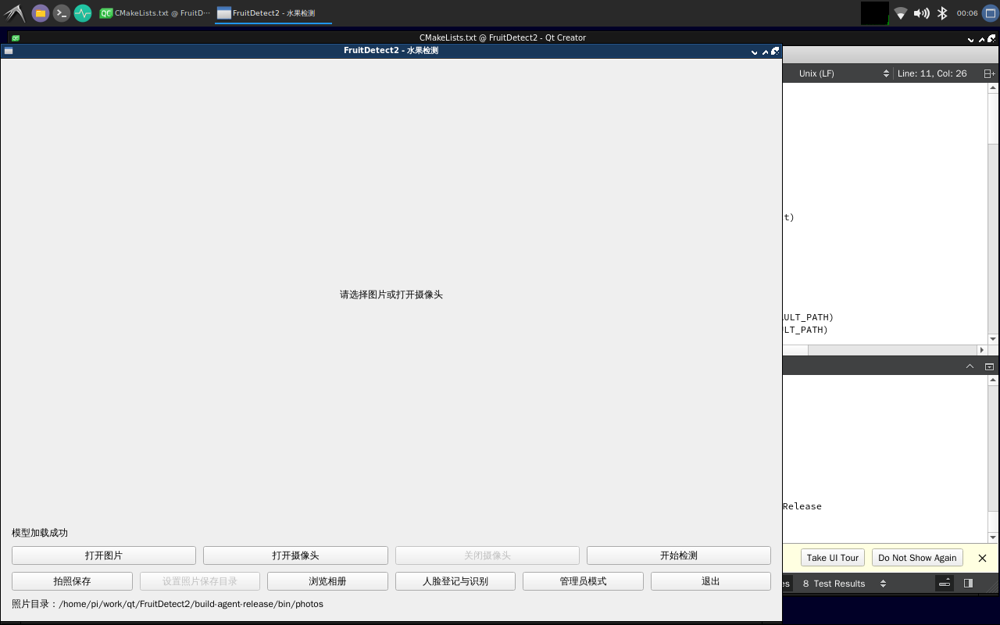
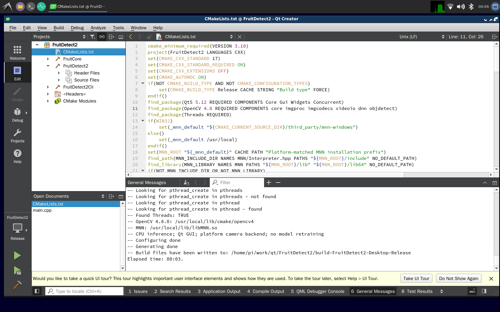

<div align="center">

# RK3399-Qt_Fruit_and_Face_Recognition

**基于 Qt 5 + OpenCV 4.8.0 + YOLOv8(MNN) 的水果识别与人脸识别系统**

Windows 桌面开发验证 → RK3399 (ARM64) 嵌入式板端部署，同一套 C++17 源码跨平台构建

[](https://www.qt.io/)
[](https://opencv.org/)
[](https://github.com/alibaba/MNN)
[](#)
[](#)
[](#)

</div>

---

## 一、项目简介

这是一个**完整的边缘 AI 视觉应用工程**：在 Windows 上用 Qt Creator 开发调试，交叉部署到 RK3399 开发板（NanoPC-T4）实机运行。水果检测使用自己训练的 YOLOv8 模型（经 MNN 转换后做 CPU 推理），人脸检测与识别使用 OpenCV Zoo 的 YuNet + SFace 预训练 ONNX 模型。

工程不是 Demo 级代码：GUI 与推理线程分离、模型加载失败有明确错误码、命令行工具支持无界面批量验收与性能采样、离线测试覆盖人脸登记/陌生人判定/管理员密码流程，板端有真实摄像头与桌面的实测记录。

### 核心功能

| 模块 | 说明 |
|---|---|
| 🍎 水果实时检测 | YOLOv8 模型识别 **apple / banana / orange** 三类，摄像头实时画面框选 + 置信度标注 |
| 👤 人脸检测与识别 | YuNet 检测人脸框，SFace 提取特征向量，余弦相似度比对 |
| 📝 人脸登记库 | 支持单人多样本登记，特征持久化到磁盘，重启后自动重载 |
| 🚨 陌生人判定 | 相似度低于阈值（默认 0.50）判定为陌生人 |
| 📷 拍照与相册 | 抓拍当前帧保存到本地，内置相册浏览器（支持中文路径） |
| 🔐 管理员权限 | 密码保护的管理操作入口，支持旧密码校验、长度边界、二次确认、持久化修改 |
| ⌨️ 命令行工具 | `FruitDetect2Cli` 无需 GUI 即可完成检测验收和多线程性能采样 |

### 技术栈

```text
界面层    Qt 5 Widgets + Concurrent（GUI / 线程 / 事件循环）
图像层    OpenCV 4.8.0  core imgproc imgcodecs videoio dnn objdetect
推理层    MNN（水果 YOLOv8，CPU 后端） + OpenCV DNN（人脸 ONNX，CPU 后端）
语言      C++17
构建      CMake 3.10+（主）/ qmake（Windows 备用）
平台      Windows x64 MSVC2017  ·  RK3399 AArch64 Debian 11
```

---

## 二、运行效果

RK3399 板端实机运行（NanoPC-T4，USB 摄像头实时检测）：



板端桌面与依赖环境自检：



> 实测环境与完整验证记录见 [`docs/rk3399-runbook.md`](docs/rk3399-runbook.md)，原始命令输出见 [`reports/rk3399/`](reports/rk3399/)。

---

## 三、目录结构

```text
.
├── src/                        业务源码（Windows / Linux 完全共享，23 个文件）
│   ├── main.cpp                GUI 入口，解析 --backend/--model/--threads/--camera 等参数
│   ├── mainwindow.*            主窗口：摄像头预览、检测绘制、功能按钮
│   ├── worker.*                推理工作线程，QMutex + QWaitCondition 与 GUI 解耦
│   ├── detector.*              推理引擎封装，MNN / OpenCV DNN 双后端可切换
│   ├── postprocess.*           YOLOv8 输出解码 + 类别感知 NMS
│   ├── face_engine.*           YuNet 检测 + SFace 特征提取 + 人脸库持久化
│   ├── face_dialog.*           人脸登记对话框
│   ├── admin_dialog.h          管理员密码流程
│   ├── photos.* / album.*      拍照存储与相册浏览
│   ├── io.*                    图像读写、命令行参数定义、结果 JSON 序列化
│   └── cli.cpp                 FruitDetect2Cli 命令行工具入口
│
├── models/
│   └── trained_fp32.mnn        自训练 YOLOv8 水果模型（12 MB，输出张量 [1,7,8400]）
│
├── face-models/                OpenCV Zoo 官方人脸模型（需脚本下载，见第六节）
│   ├── face_detection_yunet_2023mar.onnx        227 KB
│   ├── face_recognition_sface_2021dec.onnx      36.9 MB  ← 不入库
│   ├── sources.json                             官方下载地址 + SHA256 + 下载日期
│   ├── LICENSE-YuNet.txt
│   └── LICENSE-SFace.txt
│
├── scripts/
│   ├── build_windows.ps1       Windows 构建
│   ├── deploy_windows.ps1      Windows 依赖与模型部署
│   ├── build_linux.sh          Linux / 板端构建
│   ├── deploy_linux.sh         Linux 部署
│   ├── probe_linux.sh          板端环境体检（架构 / Qt / OpenCV / MNN / 摄像头节点）
│   ├── export_linux_bundle.ps1 打包纯源码 ZIP 供 SFTP 传输
│   ├── download_face_models.*  按 sources.json 校验下载人脸模型
│   └── board-env/              RK3399 板端 OpenCV / Qt / 多媒体依赖编译安装脚本
│       ├── configure_opencv_rk3399.sh
│       ├── installbase.sh
│       ├── installqt.sh
│       ├── installmedia.sh
│       ├── installgstream.sh
│       └── luanma.sh
│
├── tests/
│   ├── admin_test.cpp          管理员密码流程离线测试
│   ├── photo_face_test.cpp     拍照 / 人脸登记 / 陌生人 / 重载 离线测试
│   └── fixtures/               公开测试图片（apple_12.jpg / lena.jpg / messi5.jpg）
│
├── config/
│   ├── mnn-source.json         MNN 转换器版本溯源（tag 3.3.0 + commit + archive SHA256）
│   ├── opencv-user-options.txt 板端 OpenCV 源码构建选项记录
│   └── board_connection.json   板端连接信息
│
├── docs/
│   ├── windows-build.md        Windows 构建说明
│   ├── linux-deploy.md         Linux 部署说明（原 LINUX_DEPLOY.md）
│   ├── rk3399-runbook.md       RK3399 实机部署手册与验证结果（原 RK3399_RUNBOOK.md）
│   ├── model-pipeline.md       YOLOv8 训练 → ONNX → MNN 转换流程
│   └── images/                 README 与文档配图（板端实测截图）
│
├── reports/                    验收证据与原始命令输出（实测记录，非文档）
│   ├── acceptance.md           验收记录与证据索引（2026-11-08 Windows 侧）
│   ├── windows-build.log       Windows 构建日志
│   ├── cmake-windows-*.log     CMake 配置与部署日志
│   ├── admin-tests.log         管理员密码流程测试输出
│   ├── photo-face-tests.log    拍照 / 人脸登记测试输出
│   ├── cli-result.json         CLI 检测结果样本
│   ├── original-integrity.json 迁移前源文件完整性核对（69 个文件 PASS）
│   ├── rk3399/                 板端实测证据（环境体检、ldd、摄像头冒烟、部署日志）
│   │   ├── board_environment.txt      板端环境快照（Debian 11 / Qt 5.15.2 / OpenCV / MNN 3.6.2）
│   │   ├── board_dependencies.txt     依赖清单
│   │   ├── deploy-build.log           ARM64 Release 构建日志
│   │   ├── fruit-cli.txt              CLI 检测结果（输出张量 [1,7,8400]）
│   │   ├── camera-smoke.txt           摄像头冒烟（三次开关 + 约 20 秒连续检测）
│   │   ├── usb-camera.txt             USB 摄像头节点记录
│   │   ├── desktop-camera.txt         真实桌面摄像头验证
│   │   └── board-feature-tests.txt    板端功能测试输出
│   └── rk3399-linux/           Linux 工程侧构建与验证日志
│
├── CMakeLists.txt              主构建脚本（跨平台，含 ARM64 调优开关与离线测试开关）
├── FruitDetect2.pro            qmake 备用构建脚本（win32 / unix 双分支）
├── start-FruitDetect2.sh       板端启动脚本（自动选择已验证的 USB 摄像头稳定路径）
├── .gitignore
├── .gitattributes
└── LICENSE                     Apache 2.0（由 GitHub 仓库初始化时生成）
```

> 📌 **`LICENSE` 不在本地目录树中**：该文件由 GitHub 在创建仓库时按 Apache License 2.0 模板生成，
> 属于远程仓库的一部分。若在本地全新克隆，`git pull` 后即可看到。
> 若你是在本地已有目录上执行 `git init` 后推送，首次推送会因远程存在该提交而被拒绝，
> 处理方式见下方第 4.5 节。

---

## 四、快速开始

### 4.1 环境要求

| 依赖 | Windows（开发验证） | RK3399 板端（实机运行） |
|---|---|---|
| 操作系统 | Windows 10/11 x64 | Debian 11 ARM64 |
| 编译器 | MSVC 2017 | GCC 10.2.1 |
| CMake | ≥ 3.10（实测 3.12） | 3.18.4 |
| Qt | 5.12.12（MSVC2017 64bit） | 5.15.2 |
| OpenCV | 4.8.0（官方预编译 `opencv_world480`） | 4.8.0（源码编译，`/usr/local`） |
| MNN | Windows x64 DLL + 导入库 | 3.6.2（ARM64 `libMNN.so`） |

> ⚠️ **平台库不可混用**：`third_party/mnn-windows` 里的 DLL/`.lib` 只能给 Windows x64 链接，板端必须用 ARM64 的 `libMNN.so`。CMake 会在找不到平台匹配 MNN 时直接 `FATAL_ERROR`，不会静默降级。

### 4.2 Windows 构建

方式一：Qt Creator 打开 `CMakeLists.txt`，选 Release 构建。

方式二：命令行

```powershell
# 先按第六节下载人脸模型
cmake -S . -B build-win -DCMAKE_BUILD_TYPE=Release `
      -DOpenCV_DIR="E:/Tool/opencv-4.8.0-windows/opencv/build" `
      -DMNN_ROOT="./third_party/mnn-windows" `
      -DFRUIT_BUILD_TESTS=ON
cmake --build build-win --config Release --parallel
```

方式三：qmake（Qt 5.12.12 MSVC2017 64bit Release 套件打开 `FruitDetect2.pro`，运行 qmake 后构建）。若 OpenCV 不在默认路径，先设环境变量：

```powershell
$env:OPENCV_ROOT = "D:/your/opencv-4.8.0/build"
$env:MNN_ROOT    = "./third_party/mnn-windows"
```

产物在 `build-win/bin/`：`FruitDetect2.exe`、`FruitDetect2Cli.exe`，`models/` 与 `face-models/` 由 `FruitModels` 目标自动拷贝。

> 注：CMake 首次配置时若把 OpenCV 顶层目录自动推断成 `vc14`，需显式改为实际的 `x64/vc16/lib` 配置目录。这是 Windows 侧现象，与 Linux 配置无关。

### 4.3 RK3399 板端构建

```bash
# 1. 环境体检：确认 AArch64、Qt、OpenCV、MNN、摄像头节点
bash scripts/probe_linux.sh

# 2. 配置 + 构建（复用板端已装好的 OpenCV / MNN，不重装、不覆盖 /usr/local）
cmake -S . -B build-linux -DCMAKE_BUILD_TYPE=Release \
      -DCMAKE_CXX_COMPILER=/usr/bin/g++ \
      -DOpenCV_DIR=/usr/local/lib/cmake/opencv4 \
      -DMNN_ROOT=/usr/local \
      -DFRUIT_BUILD_TESTS=ON \
      -DFRUIT_RK3399_TUNING=ON
cmake --build build-linux --parallel 2

# 3. 检查动态依赖，必须没有 not found
ldd build-linux/bin/FruitDetect2

# 4. 启动（真实桌面会话下）
bash start-FruitDetect2.sh
```

`FRUIT_RK3399_TUNING=ON` **只给本工程 C++ 目标**追加以下编译参数，不会重建 OpenCV/MNN：

```text
-mcpu=cortex-a72.cortex-a53+crypto+crc
-mtune=cortex-a72.cortex-a53
```

CMake 会先校验架构为 AArch64、再校验 GCC 接受该参数，不满足就明确失败，不会偷偷换参数。

### 4.4 运行

程序启动后**不会自动打开摄像头**，需在界面点击"打开摄像头"。管理员初始密码 `123`。

板端摄像头节点要用已验证的稳定路径，不要用 `/dev/video0`（那是板载节点）：

```bash
./build-linux/bin/FruitDetect2 \
  --backend mnn --threads 4 \
  --camera /dev/v4l/by-id/usb-ARKMICRO_USB2.0_PC_CAMERA-video-index0
```

先用 `v4l2-ctl --list-devices` 确认实际采集节点，再通过 `--camera` 传绝对设备路径。

**验收顺序建议**：先用界面打开一张已知水果图片验证检测 → 再用已知测试照片登记并比对人脸 → 最后才测真实摄像头。因为"模型错误"和"没检测到水果"表现不同，"没登记人脸"也不等于"陌生人判定成功"。

### 4.5 一键构建脚本

上面的 cmake 命令也可以直接用仓库自带的脚本执行，脚本已内置依赖前置检查、平台库匹配校验与 `ldd` 依赖完整性检查：

```bash
# Linux / RK3399 板端（默认即 runbook 实测配置）
bash scripts/build_linux.sh --tests

# 常用可选参数
bash scripts/build_linux.sh --help
bash scripts/build_linux.sh --opencv-dir /usr/local/lib/cmake/opencv4 --mnn-root /usr/local --jobs 2
```

```powershell
# Windows
powershell -ExecutionPolicy Bypass -File scripts\build_windows.ps1 -BuildTests
```

脚本会在**非 AArch64 架构上自动关闭** `FRUIT_RK3399_TUNING`（CMake 自身也会校验架构），并在 MNN/OpenCV 缺失时给出明确提示而不是静默降级。

---

## 五、命令行工具

`FruitDetect2Cli` 用于无界面验收和性能采样，不开 Qt 窗口。

```bash
./build-linux/bin/FruitDetect2Cli \
  --backend mnn \
  --threads 4 \
  --image    /abs/path/tests/fixtures/apple_12.jpg \
  --output-json /abs/path/fruit-result.json
```

成功时退出码 `0`，标准输出 `DETECTION_PASS <检测数> <耗时>ms`。

### 5.1 参数

| 参数 | 说明 | 默认值 |
|---|---|---|
| `--backend` | 推理后端，`mnn` 或 `opencv` | `mnn` |
| `--model` | 模型**绝对路径** | `<程序目录>/models/trained_fp32.mnn` |
| `--threads` | CPU 线程数，1–64 | `4` |
| `--confidence` | 置信度阈值，0–1 | `0.25` |
| `--nms` | 类别感知 NMS 的 IoU 阈值，0–1 | `0.45` |
| `--image` | 输入图片**绝对路径**（仅 CLI） | 必填 |
| `--output-json` | 结果 JSON **绝对路径**（仅 CLI） | 必填 |
| `--output-image` | 标注图输出**绝对路径**（仅 CLI） | 可选 |
| `--warmup` | 预热次数，0–10000（仅 CLI） | `0` |
| `--iterations` | 计时次数，1–10000（仅 CLI） | `1` |

GUI 额外支持 `--camera`、`--smoke-image`、`--smoke-camera <秒>`、`--camera-cycles <次>`（自动化冒烟测试用）。

> 所有路径参数都要求**绝对路径**，相对路径直接返回退出码 2。

### 5.2 退出码

| 码 | 含义 |
|---|---|
| `0` | 成功，输出 `DETECTION_PASS` |
| `2` | 参数非法（路径非绝对、backend 未知、threads 越界、阈值越界） |
| `3` | 模型加载失败 |
| `4` | 图像读取失败 / 输出文件不可写 |
| `5` | 推理执行失败 |

### 5.3 多线程性能采样

```bash
for t in 2 4 6; do
  ./build-linux/bin/FruitDetect2Cli --backend mnn --threads $t \
    --warmup 20 --iterations 100 \
    --image /abs/tests/fixtures/apple_12.jpg \
    --output-json /abs/performance-$t.json
done
```

输出 JSON 含预处理 / 推理 / 后处理分段耗时与总体 P50、P95。**这不是摄像头端到端 FPS**，不包含采集与 GUI 显示耗时。OpenCV 与 MNN 都可能各自开线程，对比时注意线程争用。

---

## 六、模型获取

### 6.1 水果模型（已随仓库提供）

`models/trained_fp32.mnn`，12 MB，自训练 YOLOv8 权重经 ONNX 转 MNN 得到，FP32 精度，输出张量 `[1,7,8400]`（`ultralytics_single_head` 格式：4 坐标 + 3 类别）。

后处理为**类别感知 NMS**：只在同一 `classId` 内做 IoU 抑制，最多保留 300 个框。

> 训练数据集、超参与转换命令见 [`docs/model-pipeline.md`](docs/model-pipeline.md)。

### 6.2 人脸模型（需自行下载，不入库）

`face_recognition_sface_2021dec.onnx` 有 **36.9 MB**，属于 OpenCV Zoo 官方公开模型，不适合放进 Git 仓库。`face-models/sources.json` 记录了官方下载地址、SHA256 与下载日期，用脚本一键拉取并校验：

```powershell
# Windows
powershell -ExecutionPolicy Bypass -File scripts/download_face_models.ps1
```

```bash
# Linux / 板端
bash scripts/download_face_models.sh
```

脚本会校验 SHA256，不匹配即报错退出，不会留下半个损坏文件。手动下载地址：

| 文件 | 大小 | 来源 |
|---|---|---|
| `face_detection_yunet_2023mar.onnx` | 232,589 B | [opencv_zoo / face_detection_yunet](https://github.com/opencv/opencv_zoo/tree/main/models/face_detection_yunet) |
| `face_recognition_sface_2021dec.onnx` | 38,696,353 B | [opencv_zoo / face_recognition_sface](https://github.com/opencv/opencv_zoo/tree/main/models/face_recognition_sface) |

两个模型的许可证见 `face-models/LICENSE-YuNet.txt` 与 `face-models/LICENSE-SFace.txt`，**使用前请先阅读并遵守**。

### 6.3 MNN 运行库

`config/mnn-source.json` 记录了模型转换所用的 MNN 版本：

```json
{ "tag": "3.3.0", "commit": "5047919a1ae594d090ee54c7ea3403a9dee8cad4" }
```

板端实际运行的 MNN 是 **3.6.2**，与转换器版本不同。该组合已通过真实水果推理验证，但**不能据此声称所有模型都兼容**——换模型需重新验证。

Windows 侧 MNN 头文件/导入库/DLL 因体积与许可原因不入库，请从 [MNN Releases](https://github.com/alibaba/MNN/releases) 获取后放到 `third_party/mnn-windows/{include,lib,bin}`。

---

## 七、运行时数据与持久化

| 文件 / 目录 | 位置 | 说明 |
|---|---|---|
| `photo-settings.ini` | 可执行文件旁 | 照片目录设置。**Windows 里是盘符路径，不能直接拿到 Linux 用** |
| `admin-credentials.json` | 可执行文件旁 | 管理员密码 |
| `photos/` | 可执行文件旁 | 抓拍照片 |
| `face_library/` | 所选照片目录下 | 人脸特征库 |
| `face-models/` | 程序目录 | 目前需可写，用于短期模型缓存 |

**注意事项**

- 不要直接删除含照片、人脸库和密码文件的 `bin` 目录。
- 不同构建目录的照片与密码文件**互相独立**，切换程序后数据"看起来丢了"通常只是找错了目录。
- 人脸相似度阈值当前保存在内存中，重新打开窗口会恢复为 `0.50`。
- 模型目录、应用目录、照片目录都需当前用户可写；若要装到只读系统目录，先调整可写数据/缓存路径。

---

## 八、离线测试

```bash
cmake -S . -B build-linux -DFRUIT_BUILD_TESTS=ON
cmake --build build-linux --parallel 2
cd build-linux && ctest --output-on-failure
```

| 测试目标 | 覆盖内容 |
|---|---|
| `AdminTests` | 默认密码、旧密码校验、新密码长度边界、二次确认、持久化保存、退出登录 |
| `PhotoFaceTests` | 人脸模型加载、单人登记、多样本登记、持久化重载、陌生人判定、错误分支、中文路径照片保存与相册列表 |

测试只写独立临时数据，**不包含任何用户真实照片**。fixtures 用的是公开测试图片。

---

## 九、板端实测记录

以下数据来自 2026-11-09 在 NanoPC-T4 上的实机验证，完整记录见 [`docs/rk3399-runbook.md`](docs/rk3399-runbook.md)。

**实测环境**：NanoPC-T4 · Debian 11 ARM64 · Qt 5.15.2 · OpenCV 4.8.0（`/usr/local/lib/cmake/opencv4`）· MNN 3.6.2 · GCC 10.2.1 · CMake 3.18.4 · 桌面 1280×800，`DISPLAY=:0`

**已通过**

- ARM64 Release 下 GUI、CLI、AdminTests、PhotoFaceTests 全部编译成功
- `ldd` 无缺失库，链接到板端既有 `/usr/local` 下的 OpenCV 与 MNN（未重装、未覆盖）
- 默认水果模型加载与图片推理成功，输出张量 `[1,7,8400]`
- 人脸加载、单人登记、多样本、持久重载、陌生人及错误分支离线测试通过
- 中文路径照片保存与相册列表测试通过
- 管理员密码全流程测试通过
- USB 摄像头三次开启/关闭 + 约 20 秒连续检测通过，**共完成 49 次推理**
- 源码包 SHA256 `52de42e58b9a7187cd4c4665d77b20818031996f2a8ea482020a157f7f9657d9`，SFTP 传输约 13.53 秒，接收端哈希校验通过

**未完成（不作为已验收项）**

- ❌ 10 分钟长时间稳定性测试
- ❌ 全面跨平台精度一致性评估
- ❌ 真实人员识别准确率评估
- ❌ 端到端摄像头 FPS 与 NEON/OpenMP 加速收益量化

> 板端 GUI 启动时输出过 rockchip OpenGL 驱动警告，但窗口与摄像头检测均成功。本程序使用 **CPU 推理**，未改动系统图形驱动；若出现视觉异常需另行排查，不代表警告已修复。
>
> **不写没有实测支撑的加速倍数或 FPS。** 20 秒 49 次推理是含 GUI 显示的端到端短测，不能换算成性能指标。

---

## 十、构建选项速查

| 选项 | 默认 | 作用 |
|---|---|---|
| `MNN_ROOT` | Win: `third_party/mnn-windows`<br>Linux: `/usr/local` | MNN 安装前缀，须与目标平台架构匹配 |
| `OpenCV_DIR` | 自动查找 | OpenCV CMake 配置目录 |
| `FRUIT_BUILD_TESTS` | `OFF` | 构建离线测试并注册 ctest |
| `FRUIT_RK3399_TUNING` | `OFF` | 仅给本工程目标加 RK3399 的 `-mcpu`/`-mtune`，要求 AArch64 |

`FruitModels` 是 `ALL` 目标，每次构建自动把 `models/` 与 `face-models/` 拷到 `bin/`。

`INSTALL_RPATH` 已设为 `${MNN_LIBRARY_DIR};/usr/local/lib`，板端一般无需额外配 `LD_LIBRARY_PATH`。

---

## 十一、大文件与外部资源说明

本项目依赖的**工具链安装包、SDK 与板端系统镜像体积过大，不纳入本仓库**，仅在此说明获取方式。它们在本机位于工程目录之外，与源码分离保存。

### 11.1 开发工具与 SDK（约 4.9 GB）

| 资源 | 体积 | 获取方式 |
|---|---|---|
| Qt 5.12.12 Windows 安装包<br>`qt-opensource-windows-x86-5.12.12.exe` | 3.80 GB | [Qt 官方归档](https://download.qt.io/archive/qt/) 或 Qt Online Installer |
| OpenCV 4.8.0 Windows 预编译包<br>`opencv-4.8.0-windows/`（7615 个文件） | 843 MB | [OpenCV 4.8.0 Releases](https://github.com/opencv/opencv/releases/tag/4.8.0) → `opencv-4.8.0-windows.exe` |
| `opencv-4.8.0.zip`（源码） | 92 MB | 同上 Release 页 Source code |
| `opencv_contrib-4.8.0.zip` | 59 MB | [opencv_contrib 4.8.0](https://github.com/opencv/opencv_contrib/releases/tag/4.8.0) |
| Visual Studio 2017 Community | — | [VS 官方下载](https://visualstudio.microsoft.com/vs/older-downloads/) |

> 本工程的 OpenCV 依赖 **不含 contrib 的 `face` 模块**，只用 `dnn` 与 `objdetect`。所以 `BUILD_opencv_face=OFF` 可以保留，但必须确认 `BUILD_opencv_objdetect=ON`。
>
> 关闭 OpenCV 的 `WITH_GTK`/`WITH_OPENGL` **不等于**关闭 Qt Widgets——本应用不用 OpenCV `imshow` 显示窗口，界面全部由 Qt Widgets 绘制。

### 11.2 RK3399 板端系统镜像（约 1.66 GB）

| 资源 | 体积 | 说明 |
|---|---|---|
| `rk3399-usb-debian-bullseye-lxde-desktop-4.19-arm64-20260421.zip` | 1.66 GB | Debian 11 (bullseye) + LXDE 桌面 + 内核 4.19，ARM64，USB 启动镜像 |

烧录请使用**板卡厂商官方工具**（FriendlyElec NanoPC-T4 对应 [friendlyelec 官方镜像与烧录工具](https://download.friendlyelec.com/)）。镜像与烧录工具都不入库，请自行从官方渠道下载并校验。

### 11.3 板端依赖编译脚本（已入库，仅约 4 KB）

`scripts/board-env/` 下的 6 个 Shell 脚本**体积极小，已随仓库提供**，用于在 RK3399 上从源码编译安装 OpenCV / Qt / 多媒体与 GStreamer 依赖：

| 脚本 | 作用 |
|---|---|
| `installbase.sh` | 基础编译工具链与依赖 |
| `configure_opencv_rk3399.sh` | 按 RK3399 特性配置 OpenCV 4.8.0 源码构建 |
| `installqt.sh` | Qt 5 板端安装 |
| `installmedia.sh` | 摄像头 / 多媒体依赖（V4L2 等） |
| `installgstream.sh` | GStreamer 支持 |
| `luanma.sh` | 中文乱码字体处理 |

**重要说明**：`ENABLE_NEON`、`CPU_BASELINE`、`CPU_DISPATCH`、`WITH_OPENMP`、`WITH_GSTREAMER`、`WITH_FFMPEG`、`WITH_V4L`、`BUILD_opencv_*`、`OPENCV_EXTRA_MODULES_PATH` 这些都是 **OpenCV 源码构建期配置项**，写进应用的 CMake 配置里不会生效。

板端 OpenCV 已经跑正常时**优先复用**，不要自动重编译或覆盖 `/usr/local`。构建选项显示 `ON` 也不保证依赖真的找到了，要看 OpenCV 构建摘要或 `cv::getBuildInformation()` 确认实际启用状态。

同理，OpenCV 的 `WITH_OPENMP` **不会**自动开启 MNN 的 OpenMP。MNN 的线程池、CPU 算子和 ARM 指令集配置需单独确认。若单独构建 MNN，应检查固定版本选项并设置 `MNN_ARM82=OFF`，CPU 后端关闭 OpenCL/Vulkan/CUDA，安装到独立前缀后再验收，**不覆盖原库**。

---

## 十二、已知限制

- 水果检测仅支持 **apple / banana / orange** 三类，类别名硬编码在 `src/postprocess.cpp`。换模型需同步改这里的 `names[]` 数组。
- 人脸相似度阈值不持久化，重开窗口回到 `0.50`。
- `face-models/` 目录需可写（短期模型缓存），只读文件系统下需先改缓存路径。
- Windows 的 `photo-settings.ini` 含盘符路径，跨平台迁移时必须重新配置，不能直接复制。
- 推理全部走 **CPU**，未启用 GPU / NPU（RK3399 的 Mali-T860 与 NPU 均未接入）。
- 未做模型量化，`trained_fp32.mnn` 为 FP32。
- 管理员密码为本地明文流程保护，**不是安全认证机制**，不适合作为真正的访问控制。

---

## 十三、许可

- 本工程源码许可见 [`LICENSE`](LICENSE)。
- **YuNet** 与 **SFace** 模型各有独立许可，见 `face-models/LICENSE-YuNet.txt`、`face-models/LICENSE-SFace.txt`，使用前请自行确认合规。
- OpenCV 采用 Apache 2.0，Qt 采用 LGPL v3 / 商业双许可，MNN 采用 Apache 2.0。**分发或商用前请自行核对上述依赖的许可条款。**

---

## 十四、参考

- OpenCV 配置参考：<https://docs.opencv.org/4.x/db/d05/tutorial_config_reference.html>
- MNN 3.3.0 构建选项：<https://github.com/alibaba/MNN/blob/3.3.0/CMakeLists.txt>
- OpenCV Zoo 模型库：<https://github.com/opencv/opencv_zoo>
- Ultralytics YOLOv8：<https://github.com/ultralytics/ultralytics>
